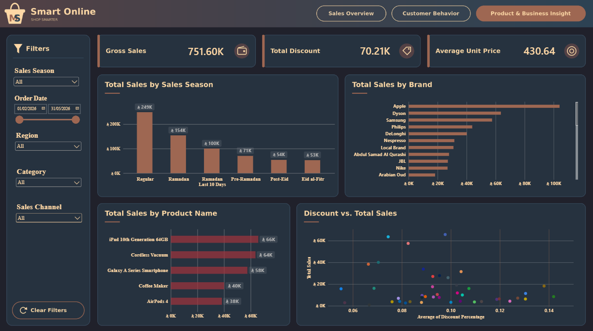

# Smart Online | E-Commerce Sales & Customer Insights Dashboard

An interactive Power BI dashboard designed to analyze e-commerce sales performance, customer behavior, and product insights. The project transforms sales data into actionable business insights through interactive visualizations, KPI indicators, and filtering.

## Demo Video

Watch the dashboard walkthrough to see the report pages, visualizations, and interactive features in action.

[Watch the Smart Online Dashboard Demo](https://drive.google.com/file/d/1Dg-msnZTyo_PTeQaFOrLPlF6HtTEXhKt/view?usp=sharing)

## Project Overview

Smart Online is a data analytics and business intelligence project developed using Microsoft Power BI. The dashboard provides an overview of business performance across three report pages, allowing users to explore sales trends, customer purchasing behavior, and product performance.

## Dashboard Preview

### 1. Sales Overview

Analyzes overall sales performance, regional distribution, product categories, monthly sales trends, and order status.

**Key insights include:**
- Total sales, total orders, and order completion rate.
- Sales performance across different regions.
- Sales distribution by product category.
- Monthly sales trends.
- Order status distribution.

### 2. Customer Behavior

Explores customer demographics, sales channels, payment methods, purchasing patterns, and customer-related metrics.

**Key insights include:**
- Unique customer count.
- Average customer rating and discount rate.
- Sales distribution by sales channel.
- Sales by order hour.
- Customer distribution by gender and age group.
- Payment method comparisons.

### 3. Product & Business Insights

Examines sales by season, brand and product performance, total discounts, and average unit prices to support business analysis.

**Key insights include:**
- Gross sales and total discounts.
- Average unit price.
- Sales comparisons across sales seasons.
- Sales performance by brand.
- Top-performing products by sales.
- Relationship between discount percentages and sales.

## Download the Power BI Report

Download the original `.pbix` file to open the report in Microsoft Power BI Desktop and explore the dashboard.

[Download Smart Online.pbix](https://github.com/Manar67Nan/smart-online-power-bi-dashboard/raw/refs/heads/main/Smart%20Online.pbix)

**Requirement:** Microsoft Power BI Desktop is required to open and interact with the report.

## Key Features

- Interactive filters for sales season, order date, region, category, and sales channel.
- KPI cards for monitoring key business metrics.
- Regional and product category sales comparisons.
- Monthly sales trend visualization.
- Customer demographic and purchasing behavior analysis.
- Brand and product performance comparisons.
- Discount and pricing analysis.
- Order status and sales channel analysis.
- Multiple dashboard pages for exploring different business perspectives.

## Tools & Technologies

- **Microsoft Power BI** — Dashboard development and interactive reporting.
- **Data Analytics** — Analysis of sales, customer, and product performance.
- **Data Visualization** — KPI cards, charts, and interactive filters.
- **Business Intelligence** — Turning business data into meaningful insights.

## Project Objectives

- Monitor key sales performance indicators.
- Identify regional and product-level sales trends.
- Understand customer purchasing behavior.
- Explore the relationship between discounts and sales.
- Compare brand and product performance.
- Support data-driven business decisions.

## Repository Contents

| File | Description |
|---|---|
| `Smart Online.pbix` | Original interactive Power BI report |
| `sales-overview.png` | Sales Overview dashboard screenshot |
| `customer-behavior.png` | Customer Behavior dashboard screenshot |
| `product-business-insights.png` | Product & Business Insights dashboard screenshot |
| `README.md` | Project documentation |

## How to Explore the Project

1. Browse the dashboard screenshots to understand the report structure.
2. Watch the demo video to see the dashboard in use.
3. Download `Smart Online.pbix` from this repository.
4. Open the file using Microsoft Power BI Desktop to explore the report and its interactive filters.

## Project Information

- **Project Name:** Smart Online
- **Category:** Data Analytics & Business Intelligence
- **Primary Tool:** Microsoft Power BI
- **Deliverable:** Multi-page interactive dashboard

