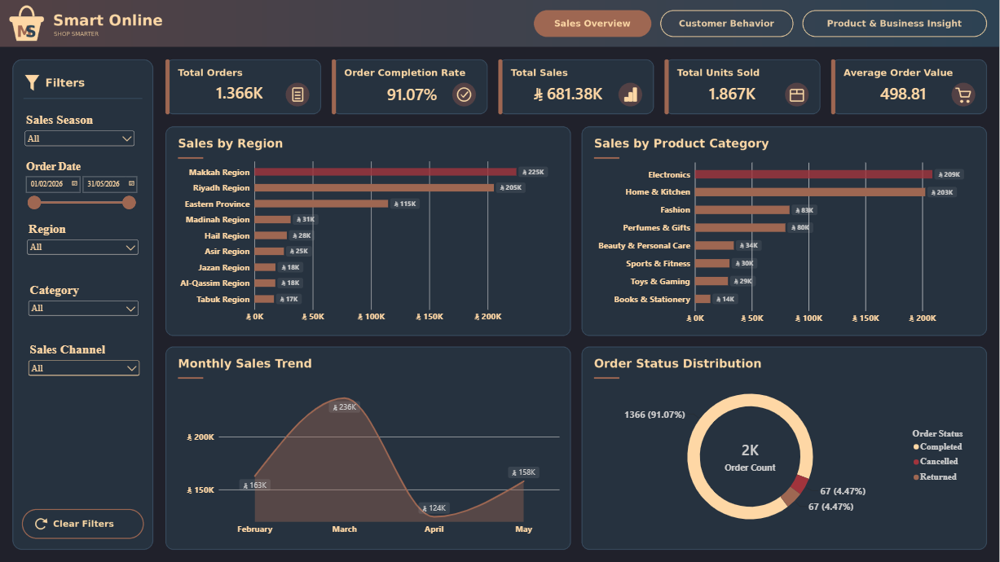
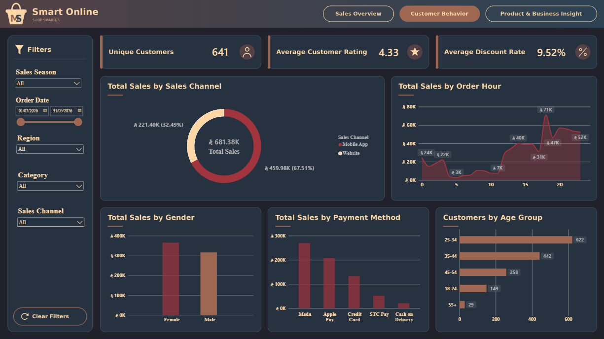

# Smart Online | E-Commerce Sales & Customer Insights Dashboard

An interactive Power BI dashboard designed to analyze e-commerce sales performance, customer behavior, and product insights. The project transforms sales data into actionable business insights through interactive visualizations and filtering.

## 🎥 Demo Video

Watch the dashboard walkthrough:

[▶️ Watch the Smart Online Dashboard Demo](https://drive.google.com/file/d/1Dg-msnZTyo_PTeQaFOrLPlF6HtTEXhKt/view?usp=sharing)

## 📊 Project Overview

Smart Online is a Power BI data analytics project focused on understanding sales performance, customer purchasing behavior, and product trends.

The report is organized into three interactive dashboard pages, allowing users to explore business performance from different perspectives.

## 🖥️ Dashboard Preview

### 1. Sales Overview

Analyzes overall sales performance, regional sales distribution, product categories, monthly sales trends, and order status.

### 2. Customer Behavior

Explores customer demographics, sales channels, payment methods, purchase patterns, and customer-related metrics.

### 3. Product & Business Insights

Examines product and brand sales performance, sales by season, discount patterns, and average unit prices to support
